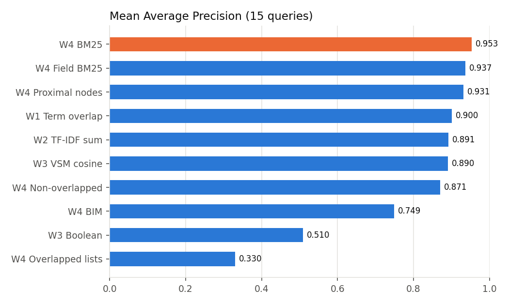
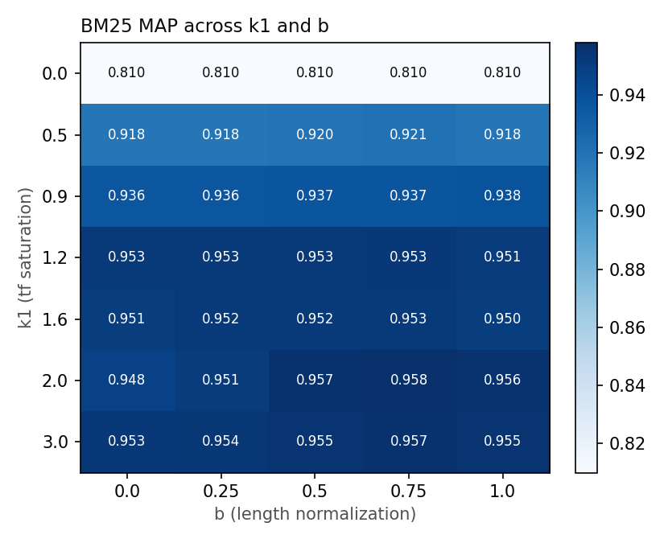
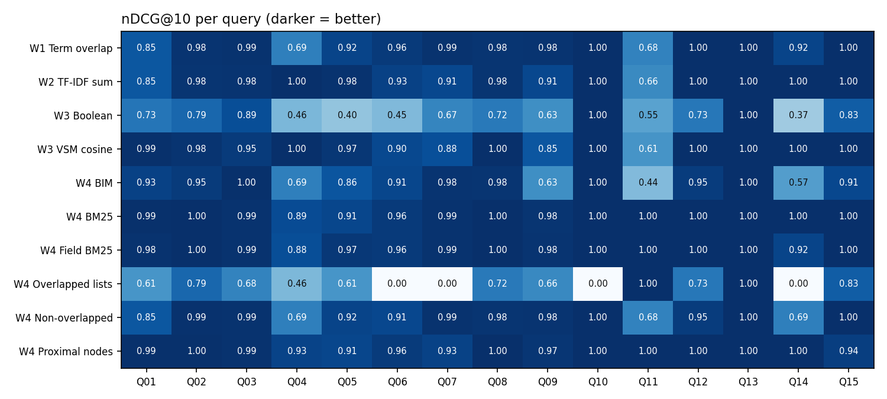

# Week 5 — Comparison and analysis: what works and what doesn't

**Setup.** Ten models from Weeks 1–4 were run on the same 40 arXiv papers (6 categories) and the same 15 test
queries. Relevance was judged by hand from titles and abstracts, graded 2 (highly relevant) or 1 (partly relevant).
Regenerate everything with `python -m week5.compare`.

## Scoreboard

| Model | Week | MAP | nDCG@10 | P@5 | Docs retrieved | Set precision | Set recall |
|---|---|---|---|---|---|---|---|
| **BM25** | 4 | **0.953** | **0.981** | **0.640** | 30.9 | 0.13 | 1.00 |
| Field-weighted BM25 | 4 | 0.937 | 0.978 | 0.627 | 30.9 | 0.13 | 1.00 |
| Proximal nodes | 4 | 0.932 | 0.974 | 0.640 | 30.9 | 0.13 | 1.00 |
| Term overlap | 1 | 0.900 | 0.930 | 0.627 | 30.9 | 0.13 | 1.00 |
| TF-IDF sum | 2 | 0.891 | 0.945 | 0.600 | 30.9 | 0.13 | 1.00 |
| VSM cosine (TF-IDF) | 3 | 0.890 | 0.943 | 0.600 | 30.9 | 0.13 | 1.00 |
| Non-overlapped lists | 4 | 0.871 | 0.909 | 0.627 | 30.9 | 0.13 | 1.00 |
| BIM | 4 | 0.749 | 0.855 | 0.493 | 30.9 | 0.13 | 1.00 |
| Boolean | 3 | 0.510 | 0.681 | 0.373 | 4.8 | **0.75** | 0.69 |
| Overlapped lists | 4 | 0.330 | 0.538 | 0.213 | 1.2 | 0.71 | 0.33 |

The best possible P@5 here is 0.733, because several queries have fewer than 5 relevant papers.

### Read this before trusting the numbers

- **The task is easy.** The six topics barely share vocabulary, so most models put the right papers near the top.
  Scores bunch up between 0.87 and 0.95, which is a ceiling effect.
- **The sample is small.** With 15 queries, gaps of about 0.02 MAP (BM25 vs. field BM25 vs. proximal) are noise.
  Only the big gaps are real: ranked models vs. BIM vs. the two set-based models.
- **The answer key is mine.** One person judged relevance, from abstracts only.

## What works

1. **BM25 is the best all-rounder.** It has the best nDCG@10 (or ties for it) on 11 of 15 queries, and its worst query still scores 0.89.
   - On Q11 *"retrieval augmented generation"*, TF-IDF cosine ranks D16 first. D16 says "retrieval" dozens of
     times but has nothing to do with RAG.
   - BM25's term-frequency saturation (k1) caps that repetition and puts D14 (SERA-IDS, an actual RAG system) first.
2. **Tuning BM25 barely matters, except turning saturation off.** Across k1 ∈ [0.9, 3] and b ∈ [0, 1], MAP stays
   between 0.936 and 0.958.
   - k1 = 0 means "only check whether the term is present", which makes BM25 binary. MAP drops to 0.810.
   - That drop is what term frequency is worth on this data.
   - b hardly matters, because every paper was clipped to similar section lengths.

   
3. **Proximal nodes help when query terms are spread across sections.** On Q04 *"large language models for
   automated code review"*, it returns all 6 relevant papers in its top 6 (nDCG 0.93, vs. 0.89 for BM25).
   - A word like "review" found in Methodology, next to "LLM" in Results, counts.
   - The same words scattered into unconnected sections do not.
   - λ = 0.7 was best (MAP 0.932). λ = 0 means "the anchor section only" and gives 0.902, so connected sections add real signal.
4. **Classification and clustering both reach 87.5% (35/40).** The mistakes are informative:
   - Naive Bayes files D03 (federated skin-lesion segmentation) under Computer Vision and D37 (biomedical image
     explanations) under Healthcare AI. Both papers really sit on the border between the two.
   - K-Means merges one healthcare paper into the segmentation cluster for the same reason.

## What doesn't work

1. **Overlapped lists are too strict for natural-language queries.** They require every query term in the same
   50-word region.
   - Q06, Q07, Q10 and Q14 (4–5 terms each) return **nothing** (nDCG 0).
   - When they do return something, it is usually right (set precision 0.71), but recall is 0.33.
   - Larger regions help both precision and recall (200-word regions: P 0.85, R 0.38). A "region" closer to a
     whole section suits this model better than a paragraph.
2. **The Boolean model can't rank.** It retrieves about 5 documents per query at 0.75 precision, the highest of
   any model, but returns them unordered. It also breaks on incidental words.
   - Q06 `dense AND (retrieval OR embedding)` pulls in D02 and D26, which use "dense" in an unrelated sense.
   - Q14's OR clause matches 16 papers (precision 0.12).
   - Writing good Boolean queries takes skill, as slide 9 warns.
3. **BIM penalizes common words.** With no relevance information, a term in more than half the papers gets a
   negative RSJ weight: log((N − df + 0.5)/(df + 0.5)).
   - "generation" (df = 31) gets −1.20 and "model" (df = 38) gets −2.73. Containing those words *lowers* a paper's score.
   - On Q11 the true answer D14 falls to rank 5 behind four unrelated papers. Q14 behaves the same way.
   - BM25's IDF, log(1 + …), is never negative, which is part of why BM25 fixes this.
4. **Non-overlapped lists are basically an OR query.** They retrieve every paper sharing any term (100% recall,
   13% precision) and rank by coverage only, ignoring term importance. That puts them below plain TF-IDF (MAP 0.871).
5. **Term overlap does surprisingly well, but for the wrong reason.** A Week 1 count of shared terms scores 0.900 MAP
   because the topics are so distinct.
   - It still fails when generic words dominate the query.
   - On Q04, D13 (LLMs for intrusion detection) ranks 2nd just for sharing "large language models automated".
6. **Field weighting by intuition backfired.**

   | Field weights | MAP |
   |---|---|
   | Uniform weights | 0.954 |
   | "Sensible" weights (title 3, abstract 2, refs 0.3) | 0.937 |
   | Title + abstract only | 0.910 |
   | Methodology + results only | 0.786 |

   - Titles here are short and full of jargon ("FedDermaSeg", "Fed-ADApt"). Up-weighting them amplifies the noise.
   - Field weights must be tuned on data, not guessed.
7. **The slide's sigmoid P = 1/(1 + e^(−s)) on raw BM25 scores is useless.** Scores of 5–30 all map to P ≈ 1.0
   (average spread across the top 10: 0.03).
   - Standardizing scores first, s′ = (s − mean)/std, spreads them to 0.21.
   - Even then the output is a score squashed into 0–1, not a calibrated probability of relevance.

## Per-query view

The hard queries are the ones whose words are common across topics:
- Q04: "large language models"
- Q11: "generation"
- Q14: "generative", "document"

Queries with a rare, specific term are solved by every ranked model:
- Q10: "melanoma"
- Q13: "quantum"

## Recommendation

| Need | Use |
|---|---|
| Default ranking | **BM25** (k1 ≈ 1.2–2, b ≈ 0.75) |
| Results that show *where* a paper matched | **Proximal nodes** or **field BM25**, with field weights tuned on data |
| Exact filtering by expert users | **Boolean**, but only as a filter in front of BM25, not as the ranker |
| A strict high-precision mode | **Overlapped lists**, with section-sized regions and short queries |
| Avoid | **BIM** without relevance feedback, and the raw sigmoid probability |

**Next steps:**
- A harder test set: more papers per topic and cross-topic queries.
- More queries, so differences can be tested for significance.
- Relevance feedback for BIM.
- Tuning BM25F field weights on held-out queries.
